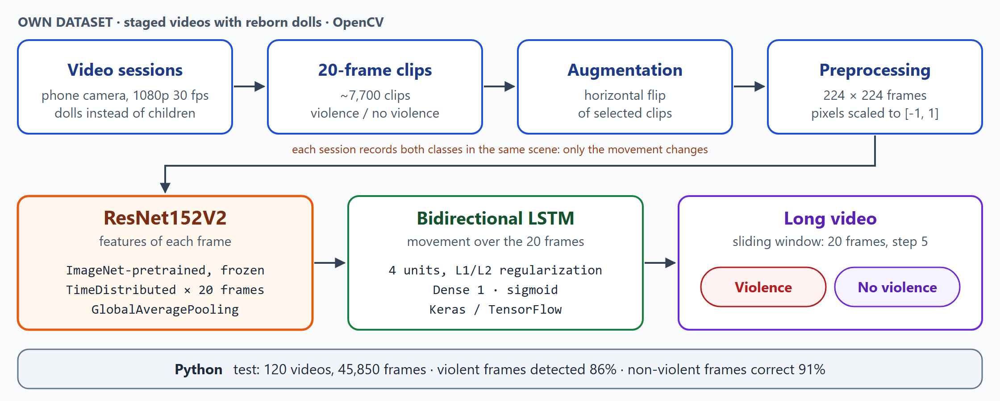
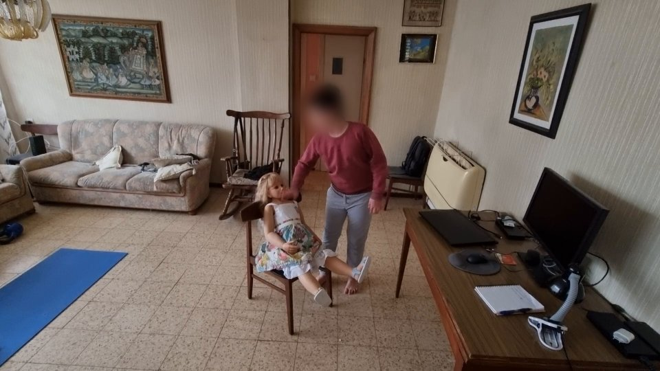
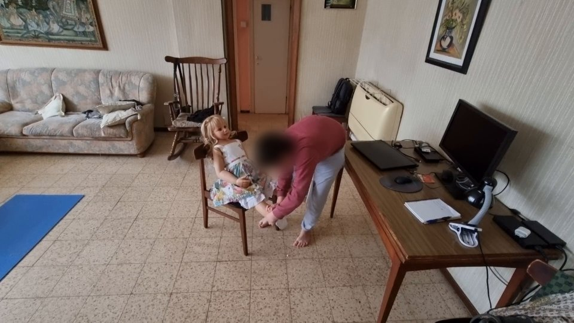
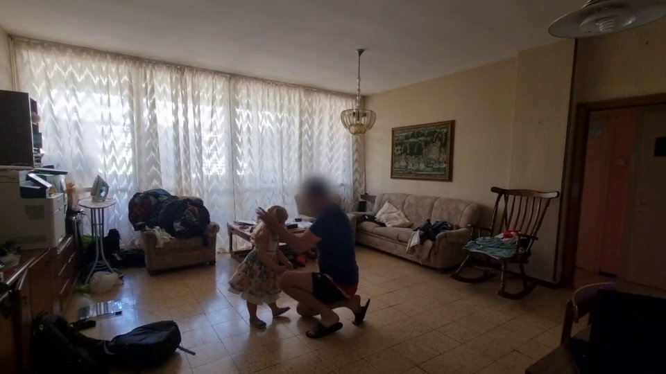
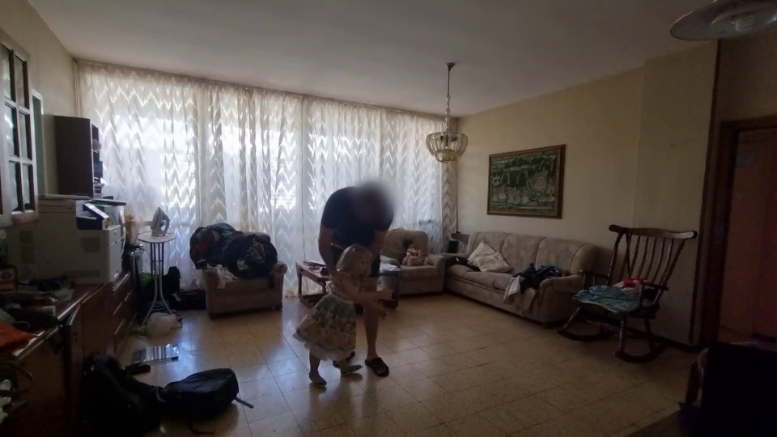
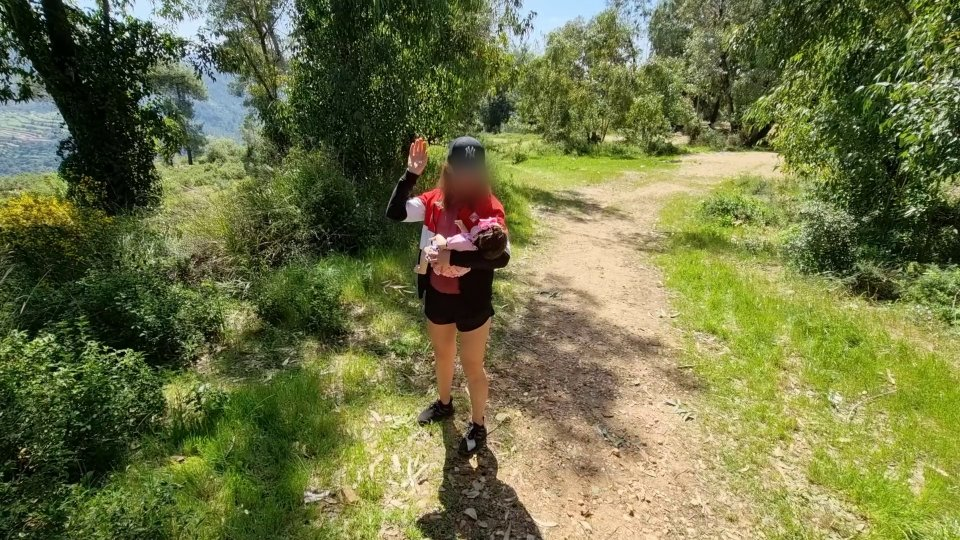

# Detection of violence against children in videos
## AFEKA - Tel-Aviv Academic College Of Engineering<br/>Department: Intelligent Systems<br/>Final project, M.Sc. in Intelligent Systems

**Project Completion Date:** 2022<br/>
**Language:** Python 3.9. Libraries: Keras/TensorFlow, pandas, matplotlib, scikit-learn, NumPy, OpenCV.<br/>
**Deep learning models:** Convolutional Neural Network (ResNet152V2) and Bidirectional Long Short-Term Memory (biLSTM).<br/>
**Development environments:** Spyder 3.3.6, PyCharm 2021.3.1.<br/>
**Cloud platforms:** Google Colaboratory, Kaggle.<br/>



---

## Motivation

Violence against children happens in every country and every society, in many forms: neglect,
physical and sexual abuse. It can have serious consequences for the child's physical, emotional
and psychosocial development.

This project focuses on **physical violence in kindergartens**. When it happens there, it often
remains unknown: the child is afraid to tell the parents, or cannot speak yet because of the age.
The project proposes a method that detects physical violence of adults against children in the
video streams of indoor surveillance cameras.

## The data problem and its solution

There is no public dataset of adult-to-child violence, and real videos are almost impossible to
obtain for privacy and legal reasons. The few videos that can be found on the Internet are short
and of low quality.

**Solution: an own, staged dataset recorded with reborn dolls** – dolls that look very much like
real children. In each recording session an adult performs both violent actions (hitting a doll
by hand or by leg) and non-violent actions with similar movements (dances, active games, sport).

| With violence | No violence |
|:---:|:---:|
|  |  |
|  |  |
|  |  |

*Frames from the staged videos. Faces are blurred.*

The most important rule of the recording: **the model must learn from the movement only.**
A model tends to use the simplest features it can find, for example the background or the clothes.
Therefore every recording session contains both classes, while everything else stays the same:
background, interior, lighting, distance from the camera, people, dolls, clothes and poses.
Between sessions these parameters were changed, to help the model generalize.

Recording and preparation:

- Mobile phone camera in a fixed position during the whole session, 1920×1080, 30 fps.
- Each recording is cut into short clips of 20 frames; the clips are sorted into
  `WithViolence` / `NoViolence` directories and labeled automatically by the directory name.
- About 7,700 clips for training and validation.
- Augmentation: horizontal flip of selected clips (files with the `_f` suffix).
- Preprocessing for ResNet152V2: frames resized to 224×224, pixel values scaled to [-1, 1].

## Model

CNN + LSTM: the CNN extracts the features of every frame, the LSTM classifies the sequence
of these features, i.e. the movement.

1. **Input** – a clip of 20 frames, 224×224×3 each.
2. **ResNet152V2** (ImageNet-pretrained, all layers frozen) with GlobalAveragePooling,
   applied to every frame through a `TimeDistributed` layer – transfer learning.
3. **Bidirectional LSTM**, 4 units, with L1/L2 (Elastic Net) regularization against overfitting.
4. **Dense** layer with one output and sigmoid activation: violence / no violence.

Adam optimizer, binary cross-entropy loss. The model size was chosen experimentally:
the goal was the smallest model that still learns the training set.

## Long video processing

A surveillance video is much longer than 20 frames, so it is processed with a sliding window
of 20 frames and a step of 5 frames. Each window is classified; the frame ranges classified
as violent are stored and overlapping ranges are merged, so the result is a list of video
fragments with violence.

## Results

The model was tested on 120 videos (45,850 frames, about 25.5 minutes) of four types.
Every test video was labeled frame by frame, and the prediction of each frame was compared with the label.

| Test videos | Violent frames detected | Non-violent frames classified correctly |
|---|---:|---:|
| Staged videos with dolls (same conditions as training) | 85.4% (1,398 / 1,638) | 89.3% (8,855 / 9,914) |
| Real videos with violence against children | 87.3% (1,390 / 1,592) | 33.9% (693 / 2,045) |
| Real videos without violence (kindergartens: dances, active games) | – | 95.6% (29,120 / 30,477) |
| Videos without people (empty rooms) | – | 100% (184 / 184) |
| **All videos** | **86.3%** (2,788 / 3,230) | **91.2%** (38,852 / 42,620) |

**Discussion:**

- Series of fast hits are detected best.
- Kicks are detected worse than hits by hand: the training set contains fewer such examples.
- In real videos with violence many non-violent frames around the violent scenes are marked as
  violent (33.9% correct), so the detected violent fragments are longer than the real ones.
- Low quality of real videos reduces the accuracy.
- The results are good mainly for videos similar to the training data. Better generalization
  needs a larger and more varied training set.

## Privacy

The real videos used for testing (videos with violence against children and kindergarten
videos) are **not included** in this repository and are not shown here, to protect the
children and the other people in them. The repository contains only staged clips with dolls
and a video without people.

## Project files

* *Code/settings.py* – global parameters: classification classes, frame size, clip length, window step.
* *Code/utils.py* – CPU/GPU mode setting, date/time string.
* *Code/frames_processing.py* – video and frame processing: reading and writing video files and frames,
  resizing, padding, extracting frames and regions, blank frames, and data augmentation
  (flipping, blurring, reversing, rotation).
* *Code/conv2d_lstm.py* – creation and training of the CNN + LSTM model.
* *Code/classification.py* – classification of long videos with the sliding window, model testing.
* *Code/How to run the code.txt* – how to run the training and the classification.
* *video_data/* – examples of training clips (the full dataset has about 8,000 clips).
* *Test/* – example test videos (staged and without people) with their frame labels.
* *Results/* – output of the training and testing runs.

## How to run

**Training:** put the dataset directory `video_data` (with `WithViolence` and `NoViolence`
subdirectories) next to the code files and run `conv2d_lstm.py`.

**Classification:** put the trained model file `conv2d_lstm_model.h5` next to the code files.
In the function `testing` in `classification.py` set the path to the directory with the test videos,
and in the `main` function uncomment the lines

```python
lst = [i for i in range(1, 120 + 1)]
testing(model, lst, False)
```

Then run `classification.py`.
